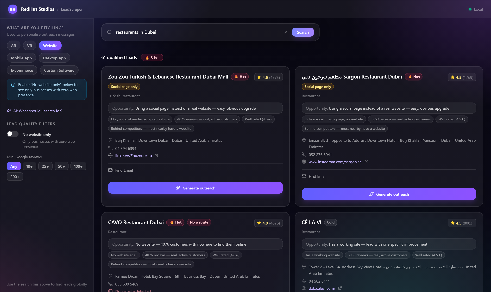
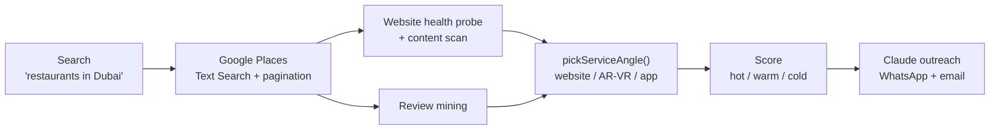
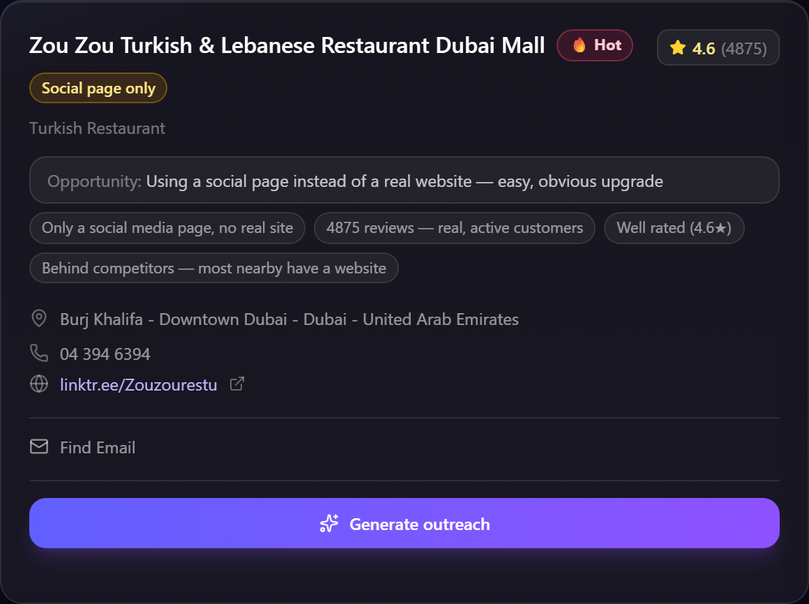
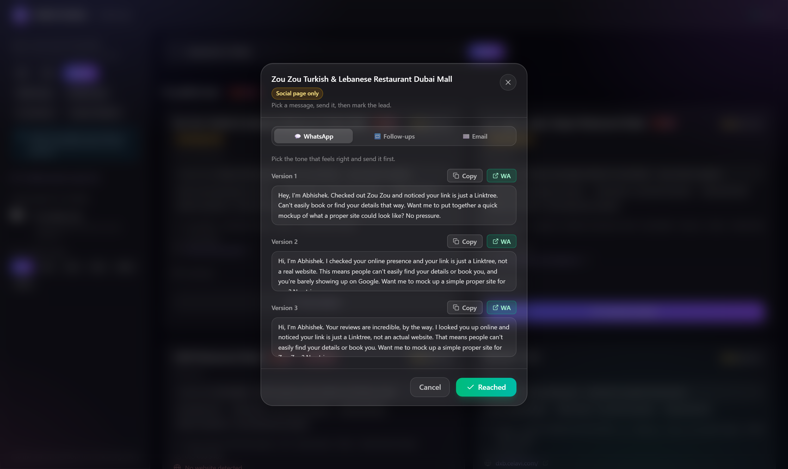
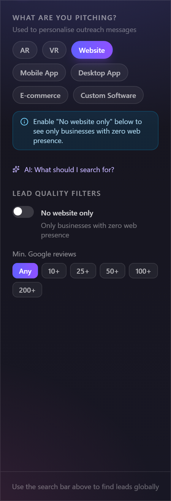
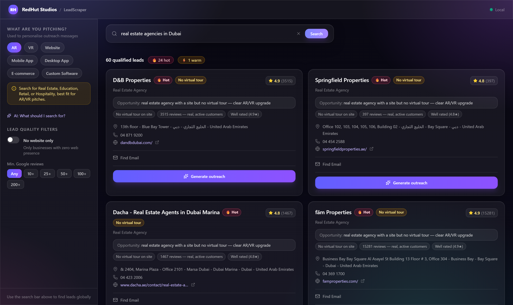

# LeadScraper

[](https://github.com/abh1shekmishra/LeadScraper/actions/workflows/ci.yml)
[](https://lead-scraper-gold.vercel.app)
[](./LICENSE)


**AI-powered lead generation that finds businesses with a _provable_ digital gap, and writes the outreach to win them.**

LeadScraper is a personal sales tool built for RedHut Studios (websites, mobile apps, AR/VR). Instead of scraping a random list, it searches real businesses on Google Maps, **visits each one's website to detect an actual, provable problem** (no site, dead site, no virtual tour, no online ordering…), scores them, and drafts personalised WhatsApp-first outreach with Claude — while refusing to make a single claim it can't back up.

<p align="center">
  
</p>

> **▶ Live demo: [lead-scraper-gold.vercel.app](https://lead-scraper-gold.vercel.app)**
>
> The demo runs in a keyless **demo mode**: it returns eight curated sample
> businesses scored through the real pipeline, so you can explore the full UI
> with no Google/Claude keys and zero cost. Toggle **Website / AR / Mobile App**
> to watch the pitch angle change per lead.

---

## Why it's different

Most "lead scrapers" hand you a spreadsheet of names. The hard part isn't finding businesses — it's finding the ones with a **real, demonstrable need** and reaching them credibly. LeadScraper is built around one principle:

> **Never make a claim you can't prove.**

Every lead is qualified by something the tool actually _checked_ ("I tried opening your site and it didn't load", "your listings have photos but no virtual tour"), and every message opens on that specific, true observation. If nothing is provably wrong, the tool says so and stays neutral — it never invents a problem to manufacture a pitch.

---

## What it does

- **Global search, plain English** — type `restaurants in Dubai` or `real estate agencies in Mumbai`. Uses Google Places Text Search with pagination (~60 leads/search).
- **Live website health check** — server-side probe of every lead's site: missing, dead, social-page-only, no HTTPS, not mobile-friendly, slow. Timeouts are treated as _unverified_ (no claim) — credibility first.
- **Service-aware qualification** — pick what you're pitching and the tool finds the matching gap:

  | You select | It finds | It pitches |
  |---|---|---|
  | **Website** | no site / dead / social-only / not-mobile | a website |
  | **AR / VR** | realtors, hotels, showrooms with **no virtual tour** | a virtual tour demo |
  | **Mobile App** | busy restaurants/salons with **no online ordering** | an ordering/booking app |
  | **Desktop / Custom** | _(no Maps signal — honestly stays cold)_ | a soft "here's an idea" only |

- **Review intelligence** — mines each business's real Google reviews to (a) detect customer-voiced demand ("couldn't book online") and (b) warmly personalise messages with genuine praise ("people love your biryani") — never quoting complaints back.
- **Hot / Warm / Cold scoring** — driven by gap severity × business strength, so your most pitchable leads float to the top.
- **Outreach that gets read** — Claude drafts 3 WhatsApp variants + 3 follow-ups + a plain "helpful heads-up" email per lead. No em dashes, no corporate filler, no fake urgency.
- **Seamless WhatsApp** — one click opens the chat with the message pre-filled, correct country code for any country.
- **Reached tracking** — mark a lead contacted; it persists across sessions and searches.

---

## How it works



The pipeline runs server-side in Next.js API routes. The website probe already downloads each site's HTML, so detecting extra signals (virtual tour, online ordering, app links) is effectively free — no extra requests.

---

## Screenshots

| Lead cards + scoring | Outreach modal |
|---|---|
|  |  |

| Filters / "what are you pitching" | AR/VR virtual-tour leads |
|---|---|
|  |  |

---

## Tech stack

| Layer | Choice |
|---|---|
| Framework | **Next.js 16** (App Router) + **TypeScript** |
| Styling | **Tailwind CSS v4** — glassmorphism UI |
| State | **Zustand** (per-card updates, `localStorage` persistence) |
| Leads | **Google Places API (New)** — Text Search + Geocoding |
| AI | **Anthropic API** — `claude-haiku-4-5` |
| Outreach | `wa.me` deep links (no WhatsApp API needed) |

---

## Getting started

```bash
git clone <your-repo-url>
cd LeadScraper
npm install

# add your keys
cp .env.example .env.local   # then fill in the values

npm run dev                  # http://localhost:3000
```

You'll need two API keys (see `.env.example`):

1. **Google Places API (New)** + **Geocoding API** — [console.cloud.google.com](https://console.cloud.google.com) ($200/mo free credit covers thousands of searches)
2. **Anthropic API** — [console.anthropic.com](https://console.anthropic.com)

### Tests and checks

The qualification logic — website-health classification, `pickServiceAngle`, and
hot/warm/cold scoring — is pure and unit-tested with [Vitest](https://vitest.dev)
(the website probe is covered with a stubbed `fetch`, including the credibility
rules: bot-blocks stay `unverified`, non-resolving domains are `dead`).

```bash
npm test        # run the suite
npm run lint     # ESLint (next/core-web-vitals + next/typescript)
npm run build    # production build + type-check
```

Every push runs **lint → test → build** in CI ([`.github/workflows/ci.yml`](.github/workflows/ci.yml)).

---

## Project structure

```
src/
├─ app/
│  ├─ api/
│  │  ├─ search/route.ts          # primary: text search → probe → score
│  │  ├─ leads/route.ts           # filter-panel path
│  │  └─ generate-messages/route.ts
│  ├─ page.tsx  ·  layout.tsx  ·  globals.css
├─ components/
│  ├─ FilterPanel/  ·  LeadCard/ (card + OutreachModal)  ·  SearchBar  ·  LeadGrid  ·  Header
├─ lib/
│  ├─ google-places.ts            # Places client (pagination, intl phone, reviews)
│  ├─ website-health.ts           # site probe + content signal detection
│  ├─ service-angles.ts           # pickServiceAngle() — the pitch engine
│  ├─ reviews.ts                  # review mining (demand + warm personalisation)
│  ├─ build-leads.ts              # assemble + score + competitor framing
│  └─ claude.ts                   # outreach generation
├─ store/useLeadStore.ts          # Zustand store
└─ types/                         # lead.ts (scoring, ServiceAngle), filters.ts
```

---

## Engineering notes

- **Credibility as a constraint, not an afterthought.** The scoring, the probe classification, and the LLM prompt all enforce "no unprovable claims." A site that times out becomes `unverified` (no claim) rather than `dead`, because a timeout could just be bot-blocking.
- **The gap drives everything.** One `pickServiceAngle()` function turns detected signals + the selected service into a single object that feeds scoring, the card badge, _and_ the outreach — so the UI and the message can never disagree.
- **Cost-aware.** Reviews come inline with the search response; the website probe reuses one fetch per site; all probes run with `Promise.allSettled` and hard timeouts so one bad site never breaks a search.

---

## Live demo

**[lead-scraper-gold.vercel.app](https://lead-scraper-gold.vercel.app)** runs with
`NEXT_PUBLIC_DEMO_MODE=1`, which makes every API route return the curated sample
set instead of calling Google Places or Claude, so it costs nothing and needs no
keys. To deploy your own:

1. Import the repo on [Vercel](https://vercel.com/new) (framework auto-detects as Next.js).
2. Add one environment variable: `NEXT_PUBLIC_DEMO_MODE=1`.
3. Deploy.

To run it for real instead, leave `NEXT_PUBLIC_DEMO_MODE` unset and add
`GOOGLE_PLACES_API_KEY` and `ANTHROPIC_API_KEY` (see [`.env.example`](.env.example)).

---

## License

MIT © 2026 RedHut Studios
